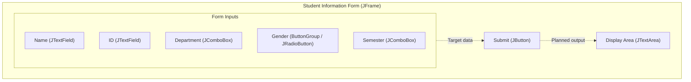

# Student Information Form

A lightweight desktop student data entry application built with Java Swing.


## Features

- **Student Identification**: Input fields for student full name and student ID (`JTextField`).
- **Department Selection**: Dropdown menu pre-populated with academic departments (`CSE`, `EEE`, `BBA`, `CIVIL`, `ENGLISH`) using `JComboBox`.
- **Gender Selection**: Radio button group (`JRadioButton` + `ButtonGroup`) ensuring mutually exclusive selection between "Male" and "Female".
- **Academic Semester Selector**: Dropdown menu covering terms `1st` through `8th` semester (`JComboBox`).
- **Result Display Area**: Embedded read-only `JTextArea` positioned to present submitted student records.

## Tech Stack

| Layer | Technology | Version |
| :--- | :--- | :--- |
| **Language** | Java (JDK) | 21+ (compiled target: Java 27) |
| **UI Framework** | Java Swing / AWT (`javax.swing.*`) | Standard Library |
| **Workspace Layout** | Visual Studio Code Java Project | Standard (`src`/`bin`) |

## Architecture

The project is structured as a single-tier desktop GUI application built using Java's standard windowing toolkit.



- **Container (`JFrame`)**: Manages absolute positioning (`setLayout(null)`) with fixed bounds.
- **Controls**: Form fields capture text, selections, and radio choices.
- **Output (`JTextArea`)**: Read-only text canvas intended for rendering output.

## Project Structure

```text
Student Information Form/
├── bin/
│   └── App.class          # Compiled bytecode output
├── src/
│   └── App.java           # Application entry point and Swing UI definition
└── README.md              # Project documentation
```

## Getting Started

### Prerequisites

- **Java Development Kit (JDK)**: Version 21 or later (uses an implicitly declared class and instance `void main()` entry point).
  Verify your installed version:
  ```bash
  java -version
  javac -version
  ```

### Installation

Clone or download the project files into your local directory:

```bash
cd "Student Information Form"
```

### Configuration

This application does not require environment variables or external database connections.

### Running

#### Option 1: Direct Source Execution (JDK 21+)
You can run the source file directly without manually compiling first:

```bash
java src/App.java
```

*(Note: On JDK 21 through JDK 23, add `--enable-preview` if preview features are required by your runtime environment: `java --enable-preview --source 21 src/App.java`)*

#### Option 2: Compile to `bin/` and Run
Compile all sources into the `bin/` directory and run the compiled class:

```bash
javac -d bin src/App.java
java -cp bin App
```

## Usage

When launched, the desktop window displays the following form interface:

| Field | Component | Options / Values |
| :--- | :--- | :--- |
| **Name** | Text field | Free-form student name |
| **Id** | Text field | Free-form student identifier |
| **Department** | Dropdown (`JComboBox`) | `CSE`, `EEE`, `BBA`, `CIVIL`, `ENGLISH` |
| **Gender** | Radio buttons (`JRadioButton`) | `Male`, `Female` |
| **Semester** | Dropdown (`JComboBox`) | `1st`, `2nd`, `3rd`, `4th`, `5th`, `6th`, `7th`, `8th` |
| **Submit** | Button (`JButton`) | Triggers submission |

## Known Limitations

These items are evidenced by inspecting `src/App.java`:
- **Unbound Action Listener**: The `Submit` button (`JButton`) does not yet attach an `ActionListener`. Clicking it does not transfer field contents into `displayArea`.
- **Window Dimensions**: The `JFrame` size is set to `350x350` pixels, but the `displayArea` is located at coordinate `y = 280` with a height of `200` pixels and width of `420` pixels. Resizing or expanding the frame is necessary to view the full text area.
- **Input Validation**: There is currently no check for empty fields or invalid student ID formats.

## Contributing

Contributions, bug reports, and enhancements are welcome:
1. Fork or branch this repository.
2. Implement your changes or fixes in `src/App.java`.
3. Test the application locally.
4. Submit a pull request.

## License

<!-- TODO: confirm LICENSE -->
No license file is currently present in this repository. Add a `LICENSE` file (such as MIT, Apache 2.0, or GPL-3.0) to specify distribution and reuse terms.

#### Option 1: Direct Source Execution (JDK 21+)
You can run the source file directly without manually compiling first:

```bash
java src/App.java
```

*(Note: On JDK 21 through JDK 23, add `--enable-preview` if preview features are required by your runtime environment: `java --enable-preview --source 21 src/App.java`)*

#### Option 2: Compile to `bin/` and Run
Compile all sources into the `bin/` directory and run the compiled class:

```bash
javac -d bin src/App.java
java -cp bin App
```

## Usage

When launched, the desktop window displays the following form interface:

| Field | Component | Options / Values |
| :--- | :--- | :--- |
| **Name** | Text field | Free-form student name |
| **Id** | Text field | Free-form student identifier |
| **Department** | Dropdown (`JComboBox`) | `CSE`, `EEE`, `BBA`, `CIVIL`, `ENGLISH` |
| **Gender** | Radio buttons (`JRadioButton`) | `Male`, `Female` |
| **Semester** | Dropdown (`JComboBox`) | `1st`, `2nd`, `3rd`, `4th`, `5th`, `6th`, `7th`, `8th` |
| **Submit** | Button (`JButton`) | Triggers submission |

## Known Limitations

These items are evidenced by inspecting `src/App.java`:
- **Unbound Action Listener**: The `Submit` button (`JButton`) does not yet attach an `ActionListener`. Clicking it does not transfer field contents into `displayArea`.
- **Window Dimensions**: The `JFrame` size is set to `350x350` pixels, but the `displayArea` is located at coordinate `y = 280` with a height of `200` pixels and width of `420` pixels. Resizing or expanding the frame is necessary to view the full text area.
- **Input Validation**: There is currently no check for empty fields or invalid student ID formats.

## Contributing

Contributions, bug reports, and enhancements are welcome:
1. Fork or branch this repository.
2. Implement your changes or fixes in `src/App.java`.
3. Test the application locally.
4. Submit a pull request.

## License

<!-- TODO: confirm LICENSE -->
No license file is currently present in this repository. Add a `LICENSE` file (such as MIT, Apache 2.0, or GPL-3.0) to specify distribution and reuse terms.

